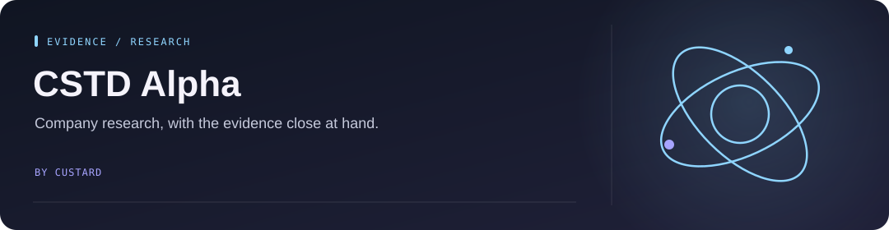

<!-- Project artwork created for this repository. -->
<p align="center">
  
</p>

<h1 align="center">CSTD Alpha</h1>

<p align="center">
  
</p>

**A personal workspace for researching companies and keeping investment evidence in one place.**

<p align="center"><a href="#what-it-does">What it does</a> &nbsp; · &nbsp; <a href="#run-locally">Run locally</a> &nbsp; · &nbsp; <a href="#checks-and-code">Checks and code</a></p>

## What it does

- Collects company evidence and builds structured research reports.
- Keeps watchlists, research notes, and investment theses together.
- Provides valuation scenarios, opportunity screening, and Word exports.
- Includes an AI research assistant behind account-based access.

This is a personal research tool. Public source code does not imply access to the hosted workspace. AI output and financial data need independent checking; nothing here is investment advice.

## Run locally

Use Node.js **22+** and the npm version in `package.json`.

```bash
npm ci
```

Copy `.dev.vars.example` to `.dev.vars`, fill in your own credentials, and configure the D1/R2/KV bindings in `wrangler.jsonc`. Follow the [setup reference](docs/MAINTENANCE.md) before running the full backend.

```bash
npm run build
npm run pages:dev
```

`npm run dev` starts the Vite frontend only. Account setup, provider settings, and background jobs are covered in the [maintenance reference](docs/MAINTENANCE.md).

## Checks and code

```bash
npm test
npm run lint
npm run typecheck:functions
```

- `src/` — browser interface.
- `functions/` — API routes, research, and valuation logic.
- `scripts/` and `.github/workflows/` — evidence collection and background jobs.

Keep credentials in local environment files or platform secrets.

Original code is available for noncommercial use under [PolyForm Noncommercial 1.0.0](LICENSE). See [license scope and third-party assets](docs/LICENSE_SCOPE.md).
